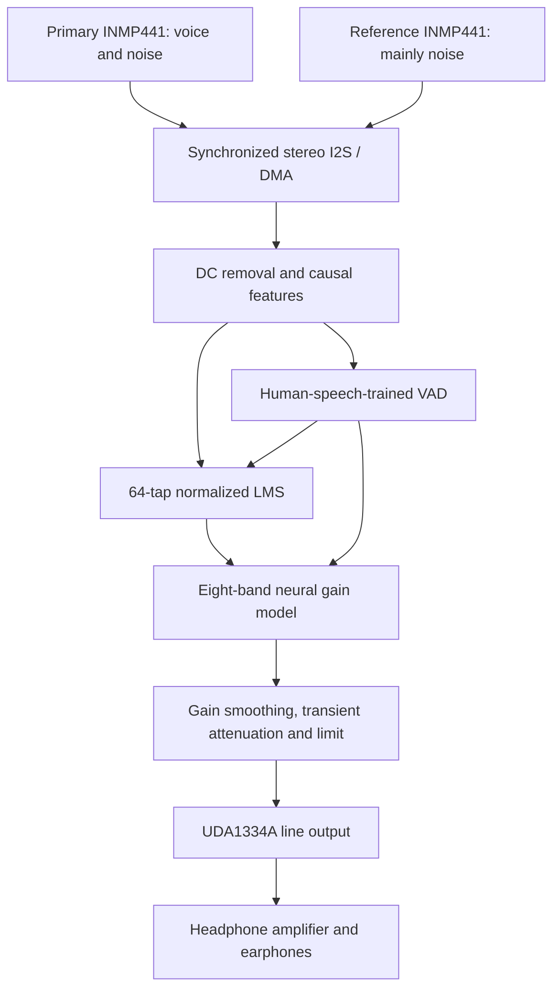

# Mounam 2.0 architecture

The node performs **communication-signal speech enhancement**. It subtracts
correlated noise in a microphone signal and applies learned band gains before
playback. Acoustic cancellation of ambient sound at the eardrum is a separate
control problem requiring appropriate headset/error-microphone hardware.

## Audio and model design

| Item | Implementation |
| --- | --- |
| Sample rate / slots | 16 kHz, stereo 32-bit slots, 24 meaningful INMP441 bits |
| Frame | 32 stereo samples = 2 ms; three DMA descriptors |
| Core 1 | Fixed-size buffers, NLMS, features, neural inference and I2S output |
| Core 0 | Serial commands, optional capture, BOOT button and telemetry |
| Adaptive path | Bounded 64-tap leaky normalized LMS; speech guards and hold control |
| ML voice controller | 8-8-1 MLP trained on real public speech with generated noise |
| ML enhancement | 26-24-8 MLP, 816 int8 weights with per-row scales, float32 activations |
| Bands | Complementary causal IIR bands with edges 125/250/500/1000/2000/3500/5500 Hz |
| Gain behavior | Bounded gains, faster opening than closing, no added FFT-frame wait |
| Transient handling | Requires a sharp reference onset as well as a primary onset; local speech alone does not trigger it |
| Calibration | Three seconds, muted, explicit noise-only learning; finishes muted |
| Timing | Device histogram reports 16-us-bin upper bounds for DSP p50/p95/p99 |
| Output safety | Muted boot, DAC MUTE pull-up, gradual unmute, digital limiter, fault mute |

The model estimates suppression gains, rather than merely classifying noise.
The complementary bands reconstruct their input when every gain is one. Each
gain multiplies an actual signal band; the model does not invent waveform samples.
Changing gains can still alter phase/timbre, so perceptual evaluation remains
necessary. This is not a complex-STFT phase-reconstruction network.

Power features use a causal 20-ms exponential history. Audio is handled in 2-ms
blocks; a history time constant is not an added 20-ms waveform buffer. The DSP
processing deadline is the block period. Microphone/DAC filters, DMA queueing and
any configured primary delay still contribute to whole-path physical latency.

The small dense model is suited to the available MCU; neither GPU inference nor
cloud access is needed. No unmeasured claim of vector acceleration is made. Host
benchmarks and ESP32 processing telemetry have different meanings; only a physical
measurement establishes microphone-to-earphone delay.

## Controls and failure behavior

The serial console and optional browser dashboard use the board's USB-UART port
at 921600 baud. The browser requests permission to open that port and reads the
same actual JSON telemetry. It is served on localhost only and does not route
microphone data to a cloud service.

BOOT taps start or compare original/neural audio; a one-second hold mutes. The
`calibrate` command explicitly enables noise-only learning with output muted. It
never automatically enables headphone output at completion. The `demo` command
then starts at low gain while preserving learned path coefficients.

Any I2S read/write failure or RX overflow latches a fault, asserts DAC MUTE and
stops the stream. Fix the fault and reset the board. Capture is bounded and
nonblocking on the audio task; corrupt/discontinuous host captures are rejected.
Telemetry crosses cores at 10 Hz, not every audio block.

The project includes a classical DSP baseline, native shared-C++ replay, training,
quantized model parity tests, source/checksum-verified images and public reports.
See [RESULTS.md](RESULTS.md) for measured software scores and their limits.
