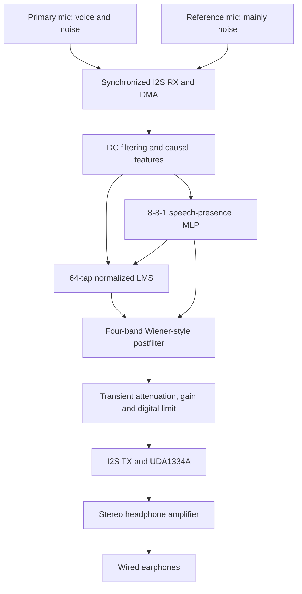

# Mounam edge

**Edge-Computed Tactical Active Noise Cancellation (ANC) Node**

SIH26052 · Idea 180588 · Team Mounam · Team ID 186962

A new, standalone implementation of the submitted Mounam architecture for an
**ESP32-S3-WROOM-1 N16P8**, two **INMP441** digital microphones, and a
**UDA1334A** stereo DAC. All runtime audio processing happens on the ESP32-S3;
training and evaluation run locally on a computer. No account, API, Wi-Fi,
Bluetooth, MQTT, web server or cloud inference is required.

## What this prototype demonstrates

This is a **dual-microphone speech enhancement and electronic audio suppression
prototype**. It estimates correlated noise in a primary microphone, subtracts it,
reduces residual noise and sends the resulting speech to an audio output. It
does **not** implement acoustic anti-noise cancellation at the eardrum. Ordinary
earphones cannot become validated gunshot protection through this software.

The architecture follows the submitted idea while correcting claims that require
measurement. See [idea alignment](docs/IDEA_ALIGNMENT.md) for the exact boundary
between implemented functions and the full problem statement.

## Start here

1. [Wire the two microphones and DAC](docs/WIRING.md). **Add a stereo headphone
   amplifier** between the DAC and your wired earphones. Until then, use a
   powered speaker/line input for output checks, or microphone capture alone.
2. [Build and flash from an Ubuntu terminal](docs/QUICKSTART.md). No Arduino IDE
   is needed. Firmware uses the pinned ESP-IDF v5.4.3 toolchain.
3. Keep output muted, verify both input channels, then compare `primary`, `dsp`
   and `hybrid` modes at the same gain.
4. [Record, train and evaluate](docs/TRAINING.md), then follow the
   [measurement plan](docs/VALIDATION.md).

## Audio architecture

The serial control/capture task runs on Core 0. The audio task runs on Core 1
with fixed buffers and no allocation or serial writes in its processing loop.
Both microphones share BCLK, WS and SD with opposite L/R straps. The DAC shares
the same BCLK and WS but uses a separate data wire. This avoids independent
sample clocks drifting apart.

| Item | Implemented configuration |
| --- | --- |
| Sampling | 16 kHz; two 32-bit I2S slots, 24 meaningful mic bits |
| Processing block | 32 stereo frames = 2 ms of audio |
| DMA | Three RX/TX descriptors per channel; TX auto-clears on starvation |
| Adaptive filter | 64-tap leaky, bounded normalized LMS; speech/transient guards |
| Residual filter | Four causal IIR bands with smoothed Wiener-style gains |
| ML | 81-parameter float32 speech-presence controller; exported C++ weights |
| Shipped model | Actually trained on **synthetic test signals**, tagged `synthetic_demo` |
| Output | Same enhanced mono signal in left and right DAC channels |
| Startup | Muted DAC and digital output; 400-ms mic settling interval |
| Controls | USB-UART at 921600 baud; mute, gain, modes, hold, delay, reset |
| Measurements | Real RMS, processing duration, overflow/error/clip/drop counters |

The MLP controls adaptation and residual gains. It is not a neural speech
reconstruction model, and no SOTA speech-quality claim is made. The portable
baseline uses scalar C++ math; ESP-DSP/vector acceleration is a subsequent
profiling-driven optimization, not an invented implementation claim.

## Validation status

Host DSP, model-export parity, capture parser, evaluation and source-split checks
are automated with `make test`. `make sanitize` runs address/undefined-behavior
checks. GitHub Actions also builds the actual ESP32-S3 firmware with ESP-IDF.
See the current PR checks for their result and [validation](docs/VALIDATION.md)
for the release record.

The included reproducible **synthetic-only** holdout has 18 examples: 13 with
harmonic voice-like signals and five noise-only examples. These are not human
speech or actual defence recordings.

| Test, same output gain | Input SNR, mean | Output SNR, mean |
| --- | ---: | ---: |
| DSP baseline | 3.32 dB | 6.98 dB |
| Hybrid with demo MLP | 3.32 dB | 10.06 dB |

Reports: [DSP](models/demo_evaluation_dsp.json),
[hybrid](models/demo_evaluation_hybrid.json), [model provenance](models/demo_model.json).
SNR >15 dB, STOI >0.85, PESQ >2.5, physical latency <5 ms, power and production
BOM are **unverified targets**. STOI/PESQ are deliberately null in these demo
reports. Real speech evaluation and hardware measurements remain necessary.

## Project layout

| Location | Purpose |
| --- | --- |
| `firmware/` | ESP-IDF board setup, I2S/DMA, Core 1 audio, Core 0 control |
| `components/mounam_dsp/` | Shared portable DSP and inference implementation |
| `host/` | C ABI used to run that same implementation on Linux/WSL |
| `ml/` | Source-disjoint dataset generation, feature extraction, NumPy training |
| `tools/` | Serial control/capture, WAV conversion, replay and paired evaluation |
| `models/` | Demo weights, provenance and honest synthetic evaluation reports |
| `tests/` | Native invariants and Python integration/metric/protocol tests |
| `docs/` | Wiring, terminal setup, training, acceptance measurements and references |

Microphone placement matters: keep the primary near the mouth and reference away
from speech. Uncorrelated noise and speech leaking into the reference limit
adaptive cancellation. Use ordinary low-level test recordings; never validate
this prototype by exposing a person to gunfire or other dangerous sound levels.
